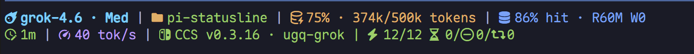
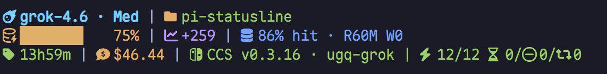
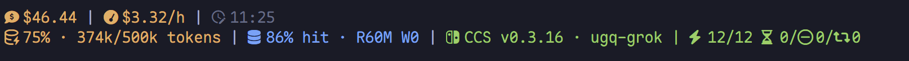
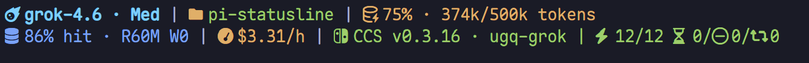
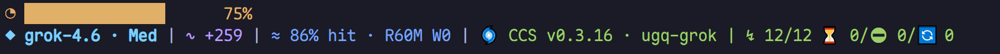
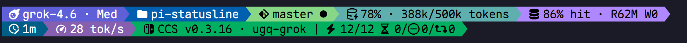
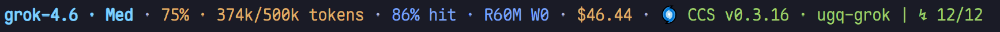
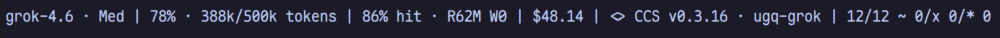

# pi-statusline

[English](README.md) | [简体中文](README.zh.md)

A [CCometixLine](https://github.com/Haleclipse/CCometixLine)-inspired status line for [Pi](https://pi.dev). Replaces the footer, with no full-screen configurator.




## Highlights

- **Your session at a glance**: model and reasoning effort, directory, Git, context use, cache hits, turn duration and `tok/s`.
- **Fits narrow terminals**: lower-priority segments step down from full to compact to minimal, then disappear if necessary. Presets do not gain extra rows.
- **Powerline warnings**: context use turns to a warning at 70% and critical at 90%. Git conflicts and stopped CCS failover also turn red.
- **Nerd Font / Unicode / ASCII**: switch with `/statusline glyphs`.
- **Third-party model costs**: uses API-reported costs first, then `~/.cc-switch/model-pricing.json`. Unknown costs show `$-.--`.
- **CCSwitch integration**: merges the status from `pi-ccswitch-auto-switch` into the last preset row.
- **Footer only**: leaves the header, editor and widgets to Pi and your other extensions.

## Install

```powershell
pi install git:github.com/miku2365/pi-statusline
```

Restart Pi or run `/reload` in your current session to load it. To update later:

```powershell
pi update --extensions
```

## Set up Pi

The default glyphs require a [Nerd Font](https://www.nerdfonts.com/). Otherwise, run `/statusline glyphs` and choose `unicode` or `ascii`.

Use `/statusline` to choose a preset and `/statusline status` to inspect the current settings. Settings are saved to `~/.pi/agent/cometix-statusline.json`.

## Presets

Choose a preset with `/statusline`. When CCSwitch is available, its status appears in the last row of each preset.

| Preset | Lines | Look | What it shows |
| --- | --- | --- | --- |
| `cometix` (default) | 2 | plain, Nerd | Model, directory, Git, context and cache; turn duration and speed |
| `dashboard` | 3 | plain, Nerd | Identity and Git; context bar, trend and cache; session and cost |
| `budget` | 2 | plain, Nerd | Cost, spend rate and clock; context and cache |
| `cache-aware` | 2 | plain, Nerd | Main row; cache and spend rate |
| `focus` | 2 | plain, Unicode | Wide context bar; model, trend and cache |
| `powerline` | 2 | powerline, Nerd | Colored main row; turn duration and speed |
| `minimal` | 1 | plain, no icons | Model, context, cache and cost |
| `zen` | 1 | ASCII, no color | For any terminal |

### cometix


### dashboard



### budget



### cache-aware



### focus



### powerline



### minimal



### zen



## Metrics

| Category | Metrics |
| --- | --- |
| Identity | `model`, including reasoning effort |
| Workspace | `dir`, `git`: `✓` / `●` / `⚠`, `↑n` / `↓n`; compact `main*`, minimal `main`; short oid for detached HEAD |
| Context | `context` (`62% · 124k/200k tokens`), `context.bar`, `context.trend` |
| Cache | `cache`: hit rate and session R/W totals |
| Cost | `cost`: session total; `cost.rate`: `$/h`, hidden when pricing is unavailable |
| Session | `session`, `duration` (turn start to idle), `tps`, `time`, `activity` |
| CCSwitch | `ccswitch`: `CCS v… · provider \| healthy cooling/disabled/switches`; available when the other extension publishes its status |

Costs use the API's `usage.cost.total` first, then rates from `~/.cc-switch/model-pricing.json`. If any token usage in the session cannot be priced, the total shows `$-.--` and the spend rate is hidden.

Costs and cache R/W accumulate across the entire session tree, including branches you have left. The latest cache hit rate, context trend, turn duration and speed follow the selected conversation branch. Switching with `/tree` clears the previous turn timer and estimates duration from the selected branch's records.

`duration` measures a whole turn until idle, including tools and retries. Full text keeps seconds after minutes (`2m5s`); compact text may show `2m`. `tok/s` divides all assistant output tokens in the turn by its wall-clock duration. After a reload, timing is estimated from message timestamps. Session duration and spend rate continue to refresh while idle.

The cache segment appears once cache reads or writes have been observed. The current branch's first cache write shows R/W without a misleading `0% hit`, even if ordinary requests came before it. Later requests show the hit rate. If the first record already reads from cache, its actual hit rate is shown immediately.

Git uses `git status --porcelain=v2 --branch`. Tool and turn completion events are debounced by 250ms. Branch changes invalidate old results immediately; no Git command runs outside a repository. Pending or failed queries do not mark a branch as clean.

Segments without data are hidden, such as Git outside a repository, cache before any cache usage, and activity while idle.

## Configuration

```json
{
  "preset": "cometix",
  "glyphs": "nerd"
}
```

Settings live in `~/.pi/agent/cometix-statusline.json`. `glyphs` accepts `nerd`, `unicode` or `ascii`. Switching presets preserves your glyph choice; `zen` always uses ASCII text and no icons without changing the saved choice. Presets and glyphs apply after a successful save without rebuilding the footer. A failed save keeps the previous settings. Invalid or unreadable settings produce a notice and fall back to defaults.

Model names, session names and other extensions' statuses may contain non-ASCII characters. Plain text is stripped of terminal control sequences. External statuses retain only SGR styling; links retain their visible text.

## Commands

| Command | What it does |
| --- | --- |
| `/statusline` | Choose a preset |
| `/statusline status` | Show settings, refresh mode and layout diagnostics for the latest frame |
| `/statusline glyphs` | Choose nerd / unicode / ascii |
| `/statusline refresh events` | Temporarily disable the one-second refresh; keep event updates and 20-second Git checks |
| `/statusline refresh live` | Restore the one-second refresh |

`/statusline status` reports the full and rendered width of each preset row, along with transitions to compact, minimal, hidden or truncated output. It describes the latest rendered frame and excludes status rows appended by other extensions.

## Requirements

- Pi 1.4
- A [Nerd Font](https://www.nerdfonts.com/) for the default glyphs; otherwise choose unicode or ascii
- Git, for installation from Git and the `git` segment

## Development

Clone the repository and run the checks:

```powershell
git clone https://github.com/miku2365/pi-statusline.git
cd pi-statusline
npm ci
npm test
npm run typecheck
```

Try the local source for one invocation without adding it to your configuration:

```powershell
pi -e .
```

For ongoing development, register the local directory:

```powershell
pi install .
```

Local installation references the directory without copying the source. Run `/reload` after changes; reinstalling is unnecessary. Before testing local source, disable the installed Git version through `pi config` to avoid loading the extension twice.

Tests use Pi 1.4's actual TUI width and ANSI truncation functions across every preset, three glyph sets, narrow terminals, Chinese text and emoji. Fixed-time scenarios cover Git, cache, mixed pricing, warnings and turn timing. Event and configuration tests isolate user files and do not modify your actual statusline settings.

## Related projects and acknowledgments

- [Pi](https://pi.dev)
- [Pi Extensions](https://github.com/narumiruna/pi-extensions)
- [CCometixLine](https://github.com/Haleclipse/CCometixLine)
- [CC Switch](https://github.com/farion1231/cc-switch)
- [pi-ccswitch-auto-switch](https://github.com/JunyWuuuu91/pi-ccswitch-auto-switch)

## License

[MIT](LICENSE)
